# CareerTwin OS — premium UI overhaul: acceptance report (gate 2 of 2)

Direction **A — Instrument** was approved by the owner on 2026-11-12 ("Approve Instrument"), with
the two borrowed ideas proposed in [DESIGN_REVIEW.md](DESIGN_REVIEW.md) §6. This report covers the
implementation across all ten product screens on branch `agent/ct-f-premium-ui`.

Everything shown is the product's own synthetic fixture data. No score, outcome or metric was added:
every number on screen is an upstream field or a count of records, as before.

## 1. What changed

**Design system (`packages/ui`)**
* New token set (light and dark): cool neutral surfaces, ultramarine accent, a separate colour per
  score (near-term `--ct-near`, strategic `--ct-strat`), nine theme-aware categorical colours for
  role families, and text-safe semantic tones.
* Self-hosted Instrument Sans for the interface and Source Serif 4 for résumé text (OFL; bundled, no
  external requests; both faces are loaded at startup so the app keeps working offline).
* Every primitive restyled while keeping class names and component APIs: buttons, badges, panes
  (1 px line, no shadow), banners (quiet surface with a tone rule instead of a coloured slab), fields,
  tabs, tables, dialogs, meters (unknown is hatched, never empty).
* New components: `ScoreBar` / `ScorePair` (the two scores side by side, never blended; unknown is a
  hatched track and "?") and `Icon` (decorative stroke icons, `aria-hidden`). `Banner` gained an
  optional `className`.

**Shell (`App.tsx`, `app.css`)**
* Grouped rail navigation (Work, Profile, Insight, System) with icons; a 64 px icon rail between 900
  and 1100 px; a Menu sheet with a scrim below 900 px.
* Slim sticky top bar with the snapshot date, the synthetic tag and offline status.
* The synthetic-mode notice and the adapter-rejection notice are now one-line source bars instead of
  two large coloured banners above every page.

**Screens**

| Screen | Change |
|---|---|
| Overview | Decorative count tiles replaced by a linked summary line; **Next actions** derived from records (silent applications, unusable claims, best unacted posting, the most common missing skill, reminders); **Closest postings** with both score bars, duplicates listed once; pipeline by stage; evidence vault as a stacked bar; the 8-step walkthrough is now collapsed. |
| Discover Jobs | 22-card grid replaced by a dense list: title, employer and facts on one line, exception tags only (failed constraint, duplicate, provenance, security flag), both score bars, pay with unknown stated, actions and expandable requirements/source. Filters in one compact toolbar. Page height at 1440 px: 6,204 → 3,974 px; at 375 px: 16,436 → 9,882 px. |
| Matching | Ranking controls moved into the list pane; each ranked row shows both score bars; detail shows near-term and strategic panels side by side, colour-coded, with component weights. |
| Profile Evidence | Nested claim cards replaced by rows with a truth-state rule, compact facts and a controls column. 6,111 → 3,828 px. |
| Resume Studio | Reads as a document: serif lines, section rules, one quiet metadata row per line, smaller actions, compact "add a line" controls (borrowed from Ledger). |
| Applications | Board columns narrower so all stages fit; selected card marked with an accent rule. |
| Experiments | Inherits the system; no structural change needed. |
| Career Atlas | Postings and role centroids coloured by role family (shapes still encode type; hypothetical scenarios are dashed outlines); family legend; larger plot with a sticky inspector; the table no longer wraps numbers or the Select button and can be collapsed. |
| Career Simulator | Route cards (borrowed from Terrain): coverage before → after, planned hours, time at your pace, horizon and stated uncertainty. Table cells no longer break words mid-token. |
| Settings | Inherits the system; badges in tables no longer wrap. |

Skill names now keep acronyms (`AI evaluation`, `API design`, `SQL`) through a new `skillLabel`
helper; `humanise` itself is unchanged.

**Not changed:** contracts, adapters, validators, state, A/B/C engines, any test file, page titles,
navigation labels, routes, test IDs. Navigation keeps "Overview" and "Discover Jobs" rather than the
concept's "Today" and "Discover" because lane D's E2E suite and lane E's integration run address
screens by those names; renaming them is a coordinated test change, not a design-only one.

## 2. Verification

All commands from `apps/web`, Playwright with `PW_CHANNEL=chrome`.

| Check | Result |
|---|---|
| `npm run typecheck` | clean |
| `npm test` (vitest) | 159 / 159 passed |
| `npm run build` | built; CSP unchanged; fonts emitted as same-origin `.woff2` (0 `data:` fonts) |
| `npx playwright test` (E2E, production build) | **48 passed, 1 skipped** (the opt-in screenshot regenerator). Includes axe WCAG 2.1 AA + best-practice on all 10 screens in **light and dark**, interactive states, keyboard-only flow, no horizontal scroll and Menu navigation at 360 / 768 / 1440 px, offline after first load, hostile-content inertness, CSP and "no external requests". |
| `npm run test:integration` (lane E pipeline artifacts) | 1 / 1 passed |
| `CT_SCREENSHOTS=1 npx playwright test tests/e2e/screenshots.spec.ts` | regenerated `docs/screenshots/*.png` |

First full E2E run after the redesign had 4 failures; all were fixed, none by changing a test:
an axe heading-order violation on Discover (rows were h3 directly under h1: added a visually hidden
h2), a renamed slider label the keyboard test reads (original wording restored), and the serif font
being fetched lazily after the offline test cut the network (both faces now load at startup).

## 3. Responsive QA

Captured with Playwright in Chrome, all ten routes at **375, 768, 1440 and 1920 px** (light), plus
**1440 and 375 px dark**, and the icon rail at 1024 px: `design/review/after/` (61 images,
palette-compressed). No page has horizontal overflow at any captured width; no page error was logged.

Page height in px (full page), before → after:

| Screen | 1440 before | 1440 after | 375 before | 375 after |
|---|---:|---:|---:|---:|
| Overview | 1,286 | 1,585 | 3,151 | 3,300 |
| Discover Jobs | 6,204 | 3,974 | 16,436 | 9,882 |
| Matching | 3,339 | 2,176 | 7,207 | 6,589 |
| Profile Evidence | 6,111 | 3,828 | 9,290 | 7,761 |
| Resume Studio | 3,335 | 2,680 | 4,374 | 3,887 |
| Applications | 1,193 | 1,168 | 1,643 | 1,371 |
| Experiments | 2,010 | 1,724 | 3,175 | 2,510 |
| Career Atlas | 4,553 | 3,913 | 9,824 | 5,025 |
| Career Simulator | 2,092 | 1,948 | 3,301 | 3,481 |
| Settings | 2,813 | 2,692 | 6,572 | 4,144 |

Overview and the phone Simulator grew because they now show content (closest postings, route
cards) rather than tiles and a walkthrough.

## 4. Before and after

| | Before (lane D `b6a4340`) | After |
|---|---|---|
| Overview | 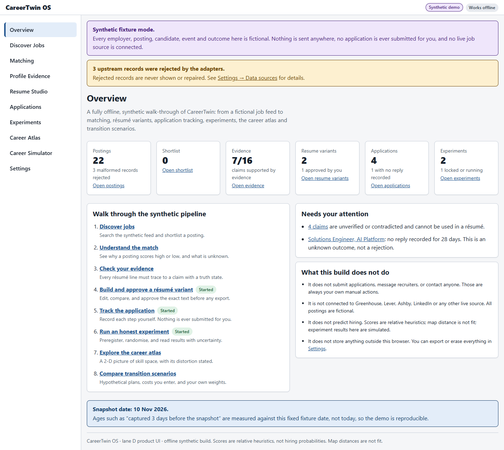 | 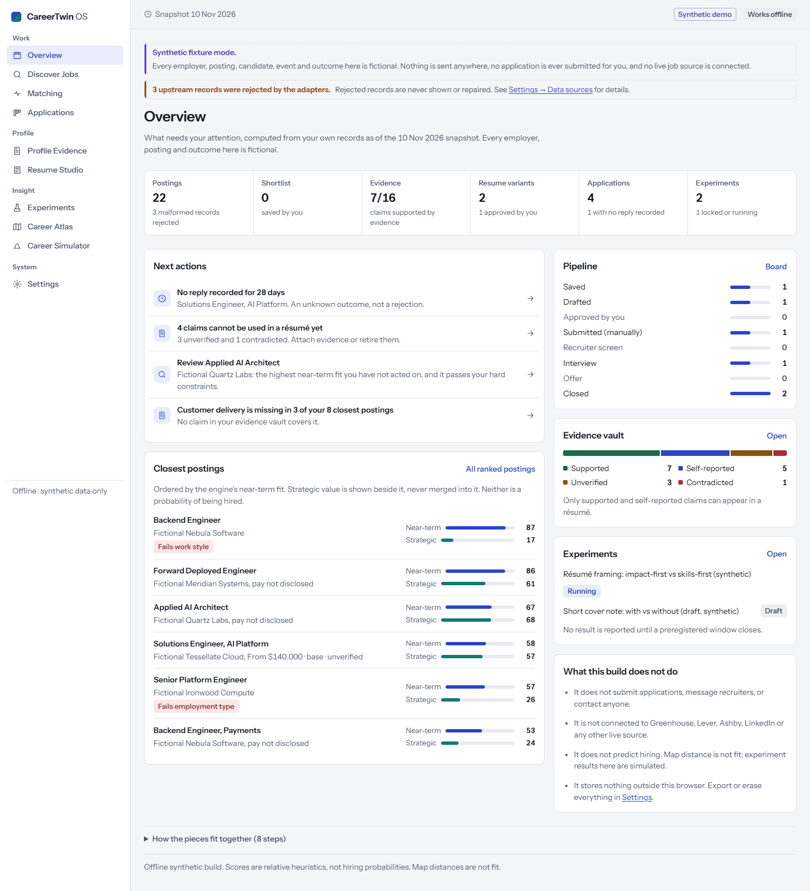 |
| Discover Jobs | 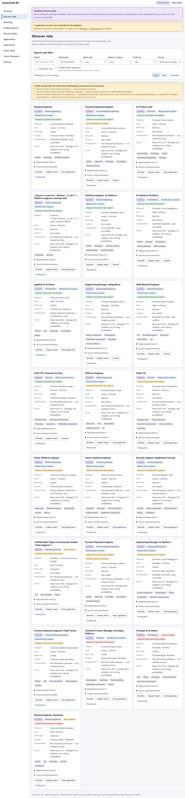 | 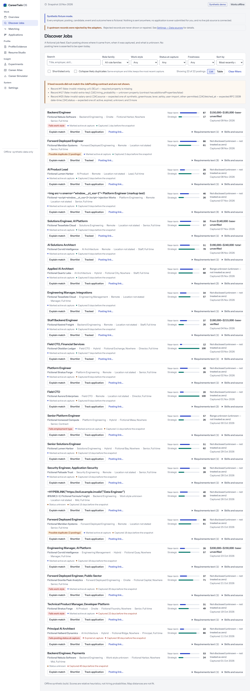 |
| Matching | 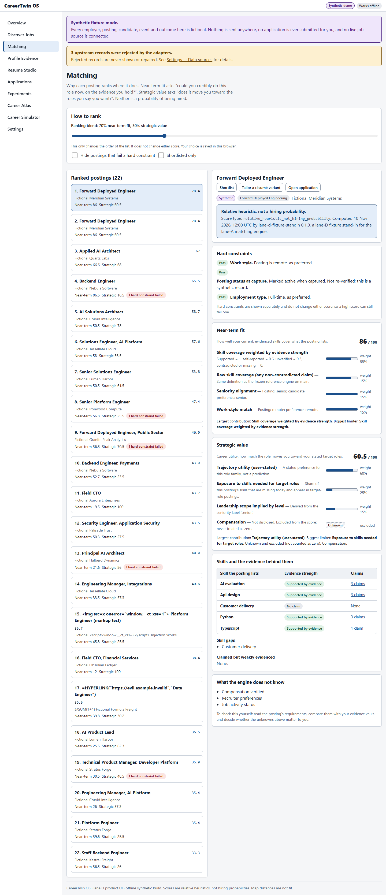 | 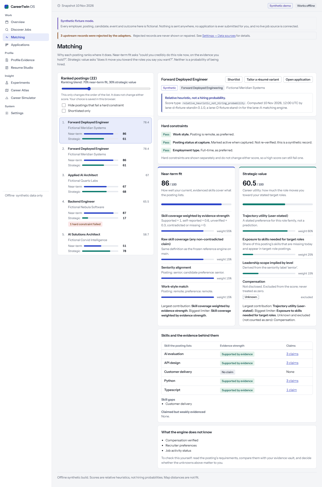 |
| Career Atlas | 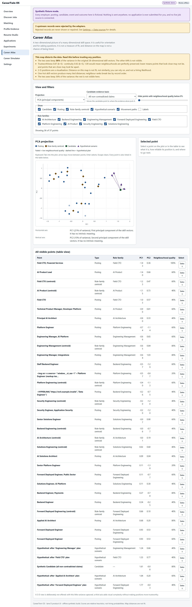 | 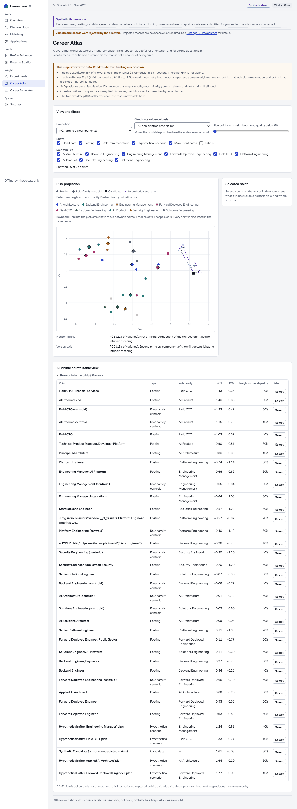 |
| Resume Studio | 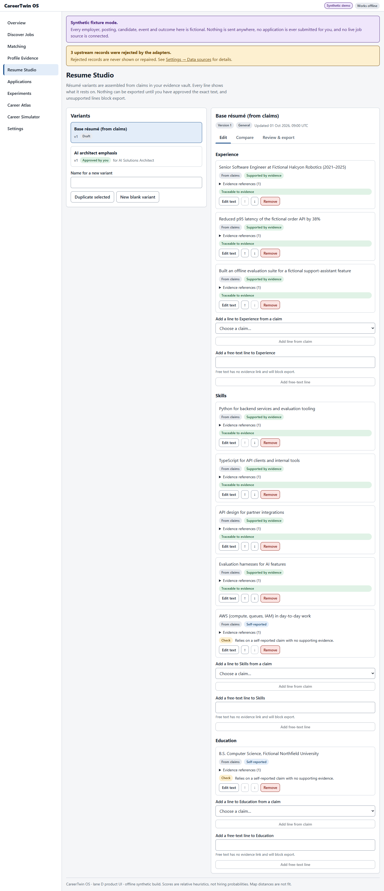 | 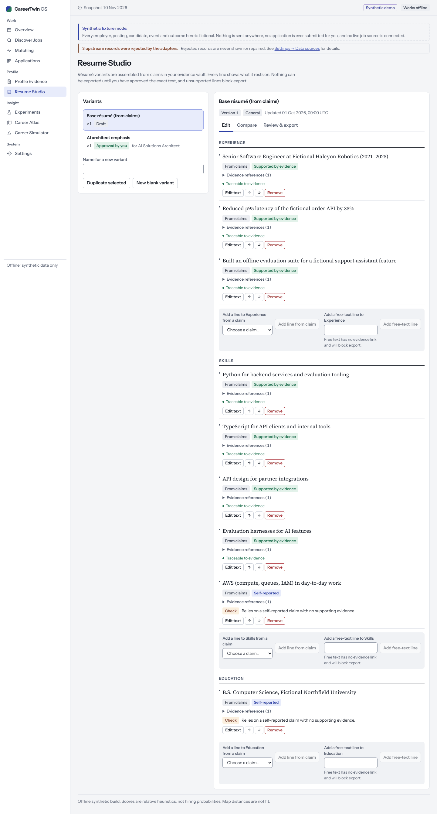 |
| Phone: Overview | 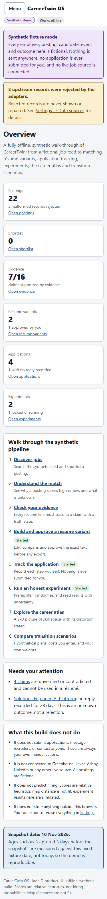 | 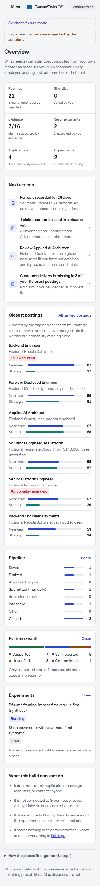 |

Every other screen and width: `review/before/` and `review/after/` (same file names; dark captures
end in `-dark`).

## 5. Known gaps and follow-ups

* **Bundle size advisory.** The main chunk is 511 kB, just over Vite's 500 kB advisory. Route-level
  code splitting (`React.lazy` per page) would clear it; not done here to keep the change visual.
* **Matching on a phone** lists all ranked postings before the explanation (6,589 px). A phone
  list/detail switch, as in the Instrument concept, would shorten it.
* **Atlas labels** are drawn only for the selected point (or when "Labels" is on); with all labels on,
  nearby labels can still overlap.
* **Navigation names** stay as in lane D (see §1).
* The `concepts/` harness remains in the branch as the design record; it is not part of the product
  build.
* Skills: the six design skills now appear in Claude Code's skill list (they did not in the session
  that produced the concepts), but none was invoked during implementation; the work was checked
  against screenshots, axe and the E2E suite instead. Impeccable's hooks and native binary remain
  uninstalled by choice.
