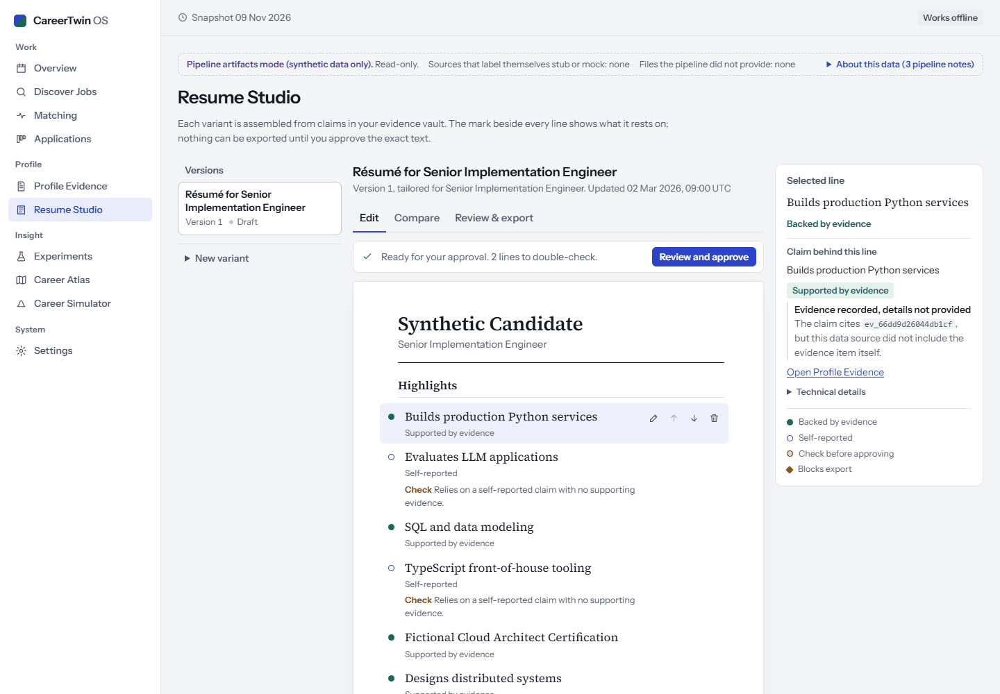
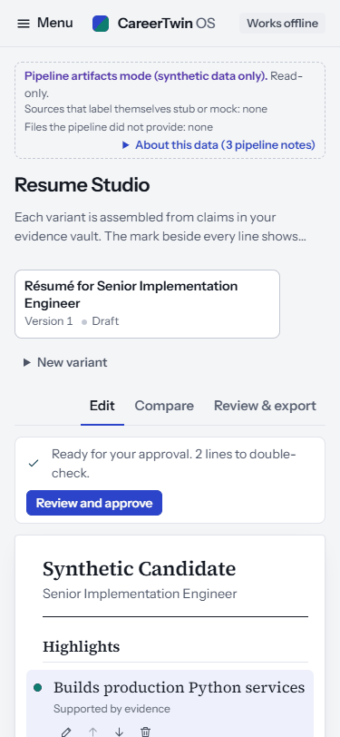
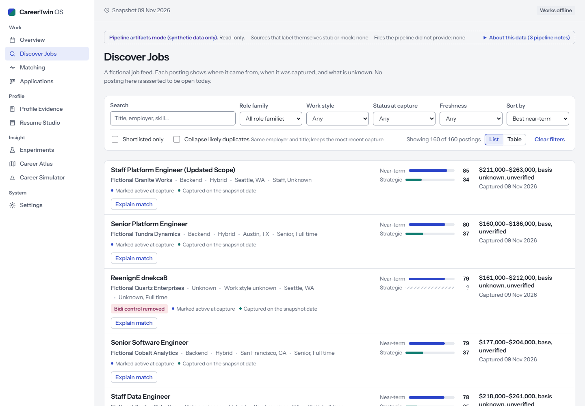
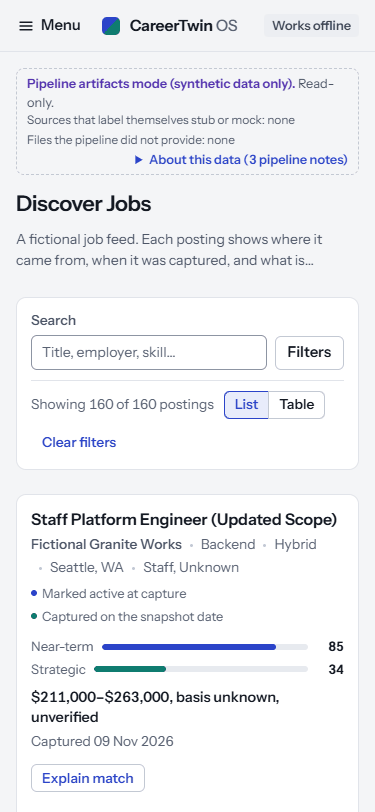
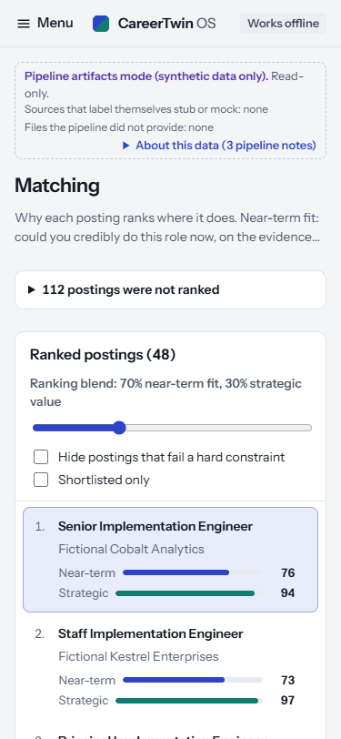
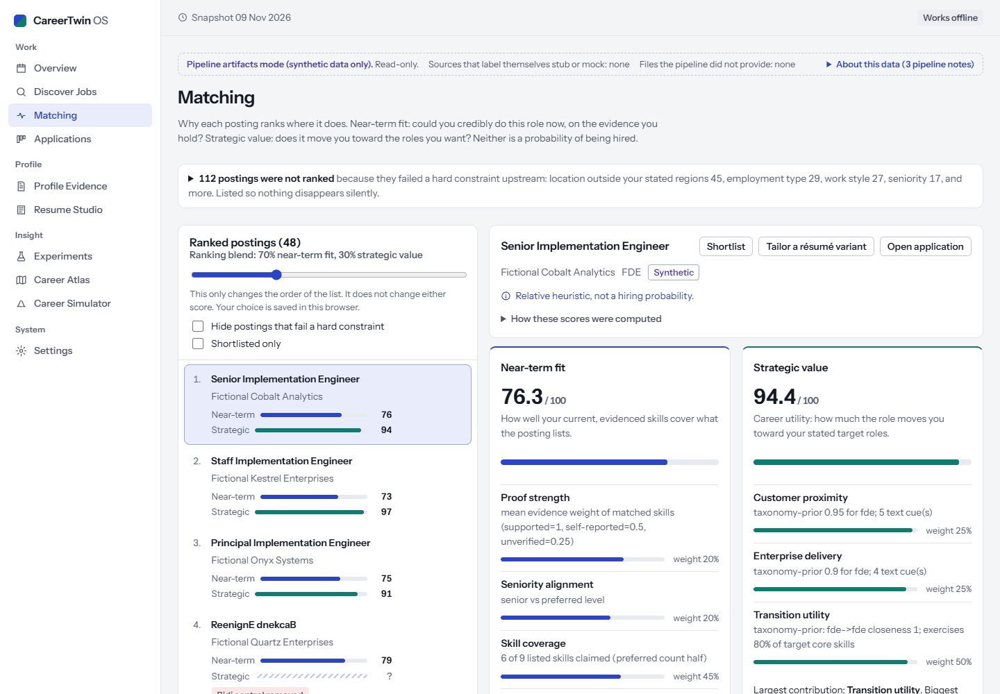
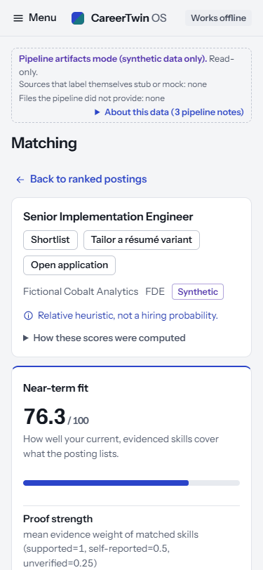
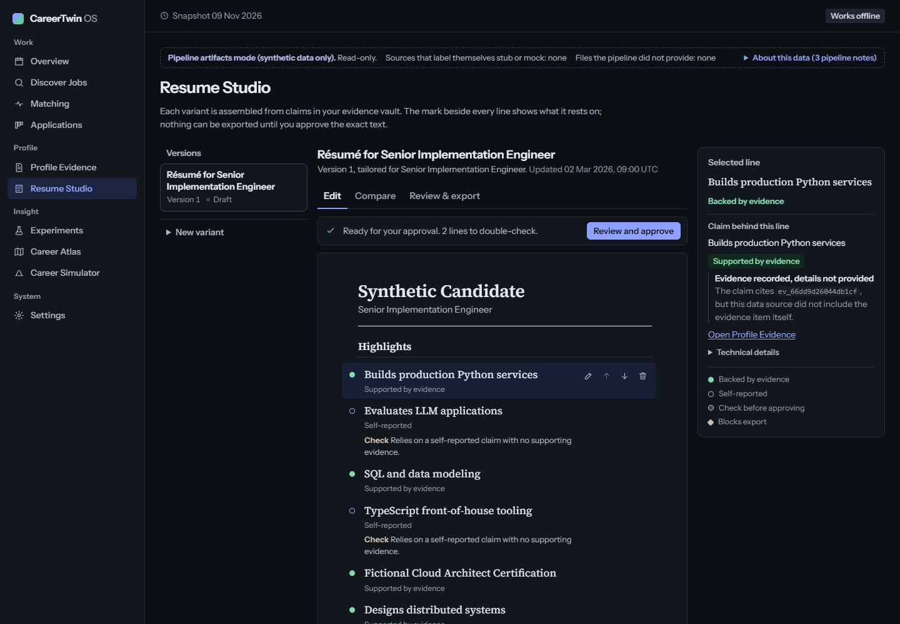
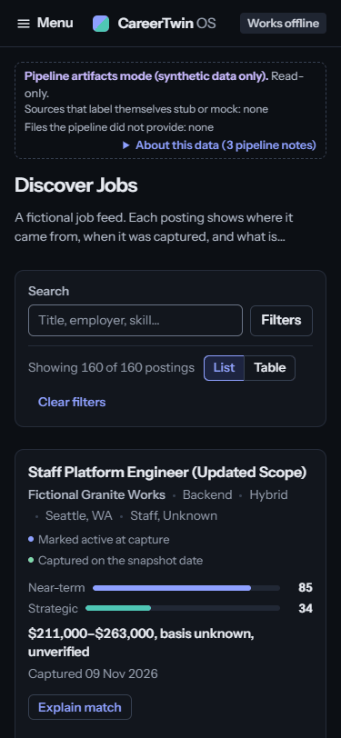

# CareerTwin OS — visual-quality correction (owner rejection of `310919f`)

Status: **awaiting owner visual approval.** Only Résumé Studio, Discover Jobs, Matching and the shared
data-source line were reworked. No other screen is claimed as finished.

All screenshots below are real browser captures (Chrome, Playwright) of the production build serving
**real synthetic A/B/C pipeline output**. That output came from lane E's acceptance launcher at `9f7219e`, run with the D slot
set to F `310919f` (`python -m ctint.acceptance --pins <local pins> --no-serve`). All nine pipeline stages
passed; the browser stage was not requested in that run. The current UI was then served on that run's
artifacts the same way the launcher does.

## 1. Design skills: invoked, and what they said

| Skill | How it ran | Recommendations used |
|---|---|---|
| **Frontend Design** | Invoked through the Skill tool | One bold element, the rest quiet (the résumé's truth gutter); no all-caps labels, middle-dot meta strings, monospace data labels or appended arrows; plan tokens and wireframes and review them against generic defaults before coding; name things in user language, not system ids. |
| **UI UX Pro Max** | Invoked; its search engine queried for list/detail, back navigation, progressive disclosure, document editing, dense tables | Database hits: predictable Back via history entries, tables scroll rather than break. Two queries for progressive disclosure found no match, so its built-in reference rules were used (`progressive-disclosure`, `back-behavior`, `deep-linking`, `state-preservation`). Labelled as fallback per the skill's own contract. |
| **Impeccable** | Invoked. Its launcher downloads and runs a native binary, which was **not run**; text guidance only. Critique Assessment A ran as an isolated subagent on the artifact-mode captures; Assessment B (detector) unavailable, so the critique is **degraded** | Score 20/40. Top issues: developer banner is the strongest element on every page; a blended "position value" on every Matching row reads as a score; raw ids as names; 112 refused postings open above 48 ranked; 160-card Discover with no best-fit sort; Résumé is a form, not a document. Craft floor: no coloured side rules on cards/alerts, no Unicode glyphs as icons, theme browser surfaces, Operate-mode restraint. |
| **Web Design Guidelines** | Invoked; rules fetched from the source URL | Paginate or virtualise lists over 50 items; URL reflects state; `theme-color`; `touch-action: manipulation`; confirm or undo destructive actions. Conflict noted: it asks for Title Case, Frontend Design for sentence case. The product keeps sentence case. |

## 2. What changed

**Data-source line (all screens).**
- The oversized artifact banner is gone. A one-line strip keeps the safety facts on screen: synthetic only, read-only, stub/mock sources and missing files.
- The long pipeline notes moved into an "About this data" disclosure. They are rewritten for people, so claim ids become the claim's own words. Each note keeps its source file name, and the raw text stays in its tooltip.
- The duplicate "Synthetic demo" chip and the rail footer note were removed.

**Résumé Studio, rebuilt as a document editor.**
- **Versions rail:** lists variants in lineage order, each with its status and blocking count.
- **Document:** a central paper page with the candidate name, target role, serif sections and lines.
- **Truth gutter:** a mark beside each line. Solid means backed by evidence, hollow means self-reported, a ring means check before approving, and a red diamond means it blocks export. Each line also carries a short citation and its findings.
- **Evidence inspector:** for the selected line it shows the claims, their truth state, the evidence items, what to do and technical ids. Below 1280 px it shows inline under the line instead.
- **Export gate:** an always-visible status ("Export blocked: N lines…" or "Ready for your approval").
- **Discreet controls:** edit, move and remove are icon buttons. They appear on hover or focus and are always visible on touch devices.
- **Machine labels:** labels like `pinned:jp_…` are shown as "Résumé for <role>". The raw label, variant id, content fingerprint and approval reference are kept under Technical details.
- **Unchanged rules:** truthfulness linting, the approval dialog, locking and the export gate behave exactly as before.

**Matching.**
- **Phone and narrow tablet:** a true list/detail flow. Choosing a row pushes a history entry, shows the explanation at the top, focuses it and announces it. "Back to ranked postings" (or browser Back) returns focus to the same row. Deep links open the detail view directly.
- **Scores first:** the two score panels now sit directly under the posting header.
- **No blended number on rows:** the per-row blended position value was removed; the blend still only orders the list.
- **Combined score:** the engine's single combined score, score type and engine name moved into "How these scores were computed". The text explains that equal range ends mean the unknown inputs don't move the score.
- **Refused postings:** the 112 refused postings are collapsed into a summary with counts by reason. Each one gets a plain-language reason, with its raw code beside it.
- **Security flags:** ingestion flags (for example "Bidi control removed") now show on the ranked rows.

**Discover Jobs.**
- **Sorting:** best near-term fit by default when match data exists.
- **Pagination:** the list shows 30 at a time with "Show 30 more". The 160-posting page was 22,846 px tall.
- **Quieter rows:** "Explain match" stays visible; the other actions and disclosures appear on hover or focus, and always on touch. Pay no longer uses middle-dot strings.
- **Role-family labels:** acronyms are kept ("Field CTO", "FDE").
- **Rejected records:** the per-record detail is behind a disclosure; the count stays visible.
- **Phones:** the secondary filters fold behind a "Filters" toggle.

**Craft-floor fixes (shared CSS).**
- Banners use tinted tone surfaces instead of 3 px side rules. Side rules were also removed from claim rows and board cards.
- Unicode ↑/↓ were replaced by drawn icons.
- Scrollbars, caret and selection are themed.
- Controls get `touch-action: manipulation`, and headings get balanced wrapping.

**Test infrastructure.**
- `CT_E2E_PORT` moves lane D's E2E preview off 4173. Lane E's acceptance launcher also serves on 4173, and when it is running, D's suite silently reused that older build.

## 3. Verification

From `apps/web`, with `PW_CHANNEL=chrome CT_E2E_PORT=4183`:

| Check | Result |
|---|---|
| `npm run typecheck` | clean |
| `npm test` | 159 / 159 |
| `npx playwright test` | **53 passed, 1 skipped** (screenshot regenerator). Includes 5 new regressions in `tests/e2e/premium.spec.ts`: Matching list/detail at 375 and 768 px (pick a lower row, detail in view and focused, Back returns focus to the row, browser Back, deep link), desktop split unchanged, artifact-mode safety facts visible with notes reachable and no machine id as a heading, Résumé truth mark, inspector and keyboard reach of line controls. |
| `npm run test:integration` (committed pipeline samples) | 1 / 1 |
| `npm run e2e:integration -- --artifacts <this run>` (real run, 160 postings) | 1 / 1, keyboard-only |

## 4. Screenshots (`design/review/correction/`)

| | Desktop 1440 | Phone 375 |
|---|---|---|
| Résumé Studio |  |  |
| Discover Jobs |  |  |
| Matching (list) |  |  |
| Matching (detail) |  |  |
| Dark |  |  |

Full-length pages without `-fold` are in the same folder.

## 5. Open issues (not hidden)

- **"Tracked" on 138 postings:** in artifact mode, lane B's A/A experiment records its 138 units as applications (`app-exp-7-…`), so those postings truthfully show "Tracked". This is a data-model question for lanes B and E, not a UI defect; the UI does not hide it.
- **Evidence item details:** the pipeline sends claims with evidence ids but no evidence items, so the inspector says "Evidence recorded, details not provided" and shows the id.
- **Removing a résumé line:** this still has no undo or confirmation (Web Design Guidelines). Proposed next.
- **Other screens:** Overview, Evidence, Applications, Experiments, Atlas, Simulator and Settings received only the shared changes; they are not part of this approval.
- **Impeccable critique:** the critique was degraded, because the detector binary was not run by choice.
