# CareerTwin OS — premium UI overhaul: design review (gate 1 of 2)

Branch `agent/ct-f-premium-ui`, cut from lane D `b6a4340` (draft PR #10 left unchanged).
Status: **owner approved direction A — Instrument on 2026-11-12.** Implemented across all ten
screens; see [ACCEPTANCE.md](ACCEPTANCE.md) for the QA evidence.

Everything shown renders the product's own synthetic fixture bundle through lane D's validated
adapters (`loadBundle(createFixtureSource())`). No job, score, outcome or metric was invented for a
mock-up: every number is an upstream field or a count of records.

Run it yourself: `cd apps/web && npm ci && npm run dev`, then open
`http://localhost:5173/concepts/` (index of all directions and screens).

---

## 1. Skills installation and activation report

| Skill | Source | Installed as | Inspected | Invocable in this session |
|---|---|---|---|---|
| frontend-design | anthropics/claude-plugins-official | project skill (folder copy) | markdown only | **No — loaded by reading SKILL.md** |
| ui-ux-pro-max | nextlevelbuilder/ui-ux-pro-max-skill@6ae86f6 | project skill | markdown + local CSV data + offline Python search; no network calls found | **No (same reason); its search engine was run directly and works** |
| impeccable | pbakaus/impeccable@c1e0e54 | project skill only | plugin ships SessionStart, PostToolUse(Edit\|Write) and Stop hooks that run a launcher, which downloads a native binary from GitHub releases on first use | **No.** Hooks **not installed**; engine binary **not run**; guidance usable as text |
| shadcn | shadcn/ui@dd41d19 | project skill | markdown; CLI fetched by `npx` only when invoked (not invoked) | No (same reason) |
| web-design-guidelines | vercel-labs/agent-skills@1a2c79d | project skill | markdown; fetches its rule list from a public GitHub URL at review time | No (same reason) |
| vercel-react-best-practices | vercel-labs/agent-skills@1a2c79d | project skill | markdown only | No (same reason) |

Why "No": `/plugin install` is an interactive Claude Code command the agent cannot run, and Claude
Code only discovers project skills in a `.claude/skills/` folder that existed when the session
started. The skills are installed project-scoped (not committed to this public repo; see
`SOURCES.txt` next to them) and become invocable in the next session. **Installing a skill is not
evidence of design quality**; the critique passes below were done against screenshots.

## 2. Jobright benchmark (public, logged-out material only)

Researched on 12 public jobright.ai pages (feature pages, one public job page, `/h1b-jobs`,
`/remote-jobs`, help/blog). No logged-in screens were captured or stored.

| Area | What Jobright does publicly | What it leaves out |
|---|---|---|
| Discovery | Dense list rows: company, posted time, title, location, work model, seniority, salary, industry, headcount, funding stage; H1B tags with a written definition | Match % is not visible logged-out |
| Filters | Title, location, work model, experience, job type | Date posted and company stage are display-only |
| Match explanation | "Decision aid — not a guarantee"; factors named: experience, skills, seniority, industry | No visible per-factor numbers; explanation goes through a chat assistant |
| Résumé | Improve an existing résumé, review every edit, PDF/Word export; says it should not invent qualifications | Keyword score mechanics not shown |
| Tracking | "Every submission is tracked"; autofill extension; gated auto-apply | No visible stage model |
| Trust | Several honest hedges (H1B, match score) | Outcome claims (3x interviews, 4x chances, 80% time saved) have no visible method and differ across pages; repeated testimonials |

**Where CareerTwin can be materially better:** show the score's components and weights in place
rather than behind a chat; separate "fit now" from "strategic value"; treat unknown pay, unknown
outcomes and unverified claims as visible unknowns; never present outcome statistics without
method; no auto-apply. **Where Jobright is ahead today:** list density and scan speed, company context
on every row, fast filtering, a single focused job detail. The recommended direction closes those.

Linear and Attio (public sites): monochrome surfaces with one accent, 13–14 px UI type with tabular
figures, grouped sidebars, panes divided by 1 px lines instead of nested cards, document-style detail
with a properties column, and keyboard-first navigation. That is the quality bar used below. No
proprietary code, artwork or layouts were copied.

## 3. Current CareerTwin UX audit (lane D `b6a4340`)

Screenshots: `design/review/before/*.png` (all ten screens at 1440 and 375 px).

| Screen | Evidence | Problem |
|---|---|---|
| All | two stacked banners (purple "synthetic", amber "rejected records") above every page | ~180 px of every screen spent on status; reads as an alert, not an identity |
| Overview | six count tiles + an 8-step walkthrough | the decorative-KPI pattern you rejected; nothing tells you what to do next |
| Discover jobs | 22 cards × ~12 label/value rows; page 6,204 px tall at desktop, **16,436 px on mobile** | no list/detail; impossible to compare postings; disclaimers repeated per card |
| Matching | list + detail exists | strongest screen structurally, but flat typography and no visual hierarchy between the two scores |
| Résumé studio | each line is a card with 3 badges and 4 buttons | the document disappears; reading is impossible |
| Career atlas | ~330 px plot, then a 37-row table | the map is a thumbnail; **bugs:** coordinates wrap mid-number ("-1.4 / 3") and the Select button wraps ("Selec / t") |
| Mobile | every page is a long single column with desktop content | no mobile navigation pattern beyond a menu |

What is already excellent and must be kept: truthful labelling, unknown-never-zero, approval
gates, keyboard-operable plot, no HTML from data, the adapters and validators.

### Feature categories

1. **Implemented in CareerTwin today** (lane D app + lanes A/B/C): synthetic feed, explainable two-part
   scores, hard constraints, evidence vault with truth states, résumé variants with approval gate,
   application event log with stages, preregistered experiments with withheld results, PCA and
   interpretable-axes atlas with fidelity metrics, hypothetical scenarios, export/erase.
2. **UI buildable now on synthetic data:** command/search bar, saved filters, compare-two-postings,
   side-by-side résumé diff, pipeline board with next actions, route planner over scenarios,
   per-point atlas inspector, notification centre for silent applications.
3. **Needs new backend, live services or owner authorization (shown as unavailable, never as working):**
   live ATS feeds, company enrichment (headcount, funding), salary benchmarks, LinkedIn import or
   sign-in, email/calendar sync for outcomes, any AI assistant using a paid model, accounts and
   multi-user data, mobile push.

## 4. Design system (shared foundations)

* **Type:** one variable family per direction, self-hosted (OFL packages; no external font requests).
  Scale 12 / 13 / 14 / 16 / 20 / 24–28 / 40 px; tabular figures everywhere numbers align.
* **Colour:** tokens only (`--ink`, `--ink-2/3`, `--surface`, `--line`, `--accent`, `--near`,
  `--strat`, `--ok/warn/bad` + soft fills), light and dark sets. Measured text contrast:
  Instrument ink 16.2:1, secondary 5.4:1 light / 5.0:1 dark; family colours ≥ 3.3:1 light and
  ≥ 7.4:1 dark against their surfaces.
* **Semantic encodings:** fit-now and strategic value always shown as **two separate bars, never
  blended**; unknown = diagonal hatching, never zero; low map fidelity = faded mark; hypothetical =
  dashed outline.
* **Spacing:** 4 px base (4/8/12/16/24/32); panes divided by 1 px lines, radius 6 (controls) / 10
  (panes); no nested cards, no decorative gradients or shadows.
* **Motion:** only in response to an action (selection, expand), ≤ 150 ms, removed under
  `prefers-reduced-motion`.
* **Accessibility floor:** visible 2 px focus ring, 44 px touch targets on phone navigation, every
  chart has a text equivalent and keyboard operation, landmarks and `aria-current`.

## 5. Three directions

### A — Instrument (recommended)
A calm, dense workspace for running a complex search like an operation. Rail navigation, a command
bar, list-and-detail panes, two separate score bars as the signature element. Instrument Sans.

| Today | Discover | Career atlas |
|---|---|---|
| 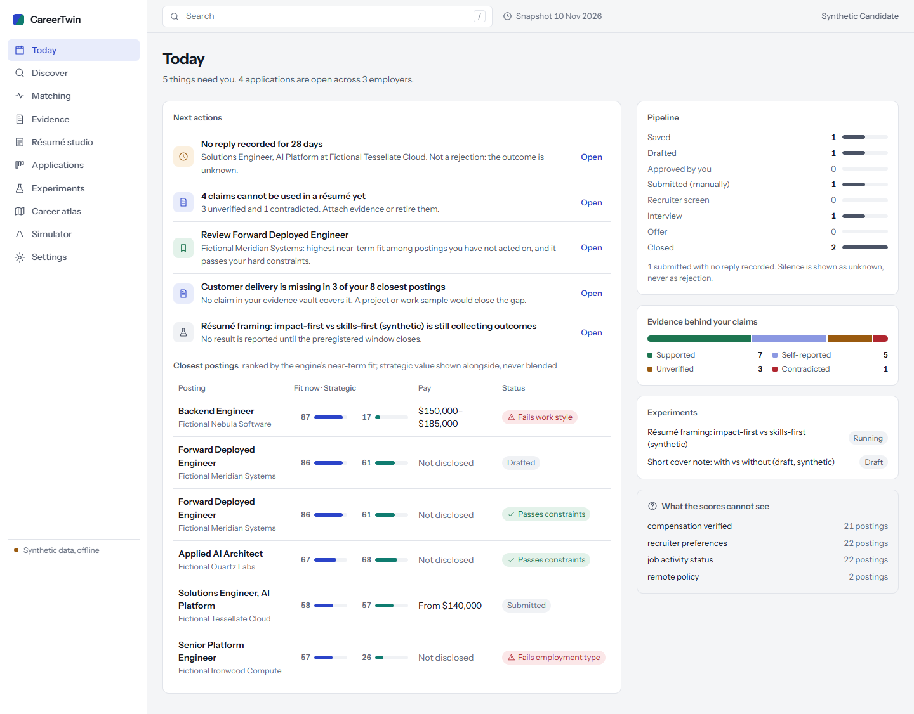 | 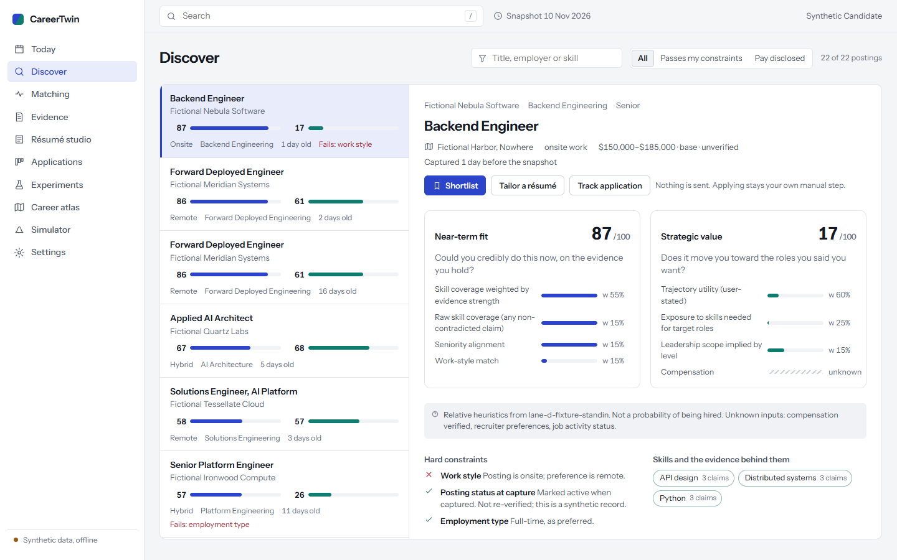 | 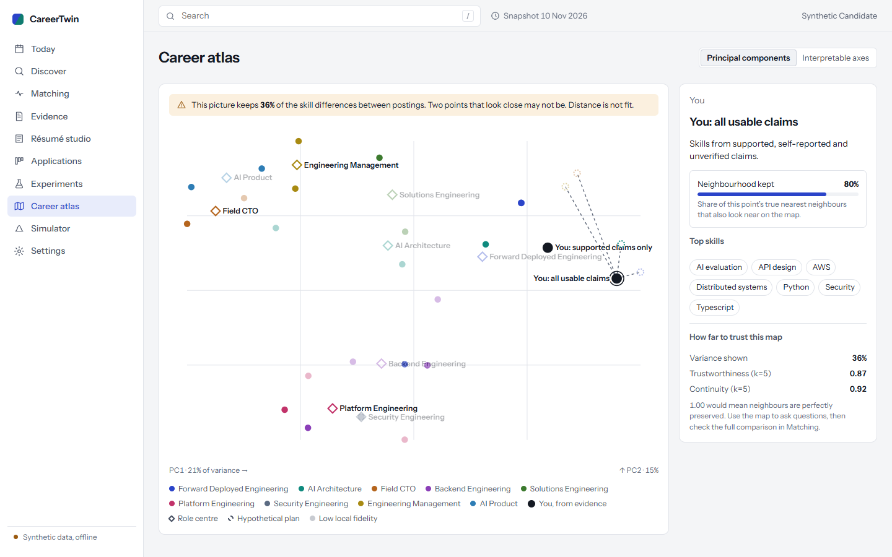 |

Dark theme and phone (375 px, first screen):

| Dark: Discover | Dark: Atlas | Phone: Today | Phone: Discover | Phone: Job | Phone: Atlas |
|---|---|---|---|---|---|
| 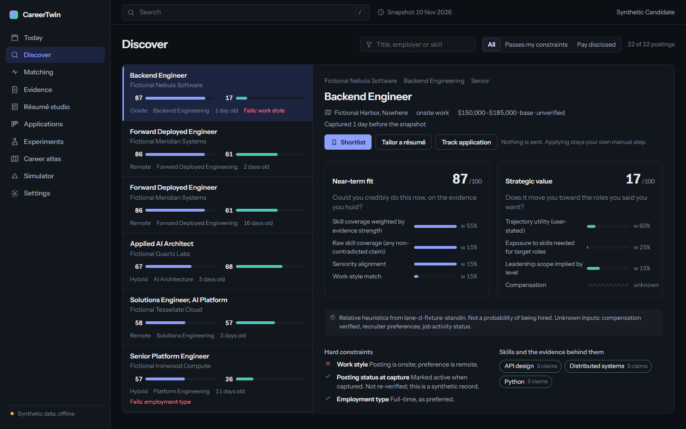 | 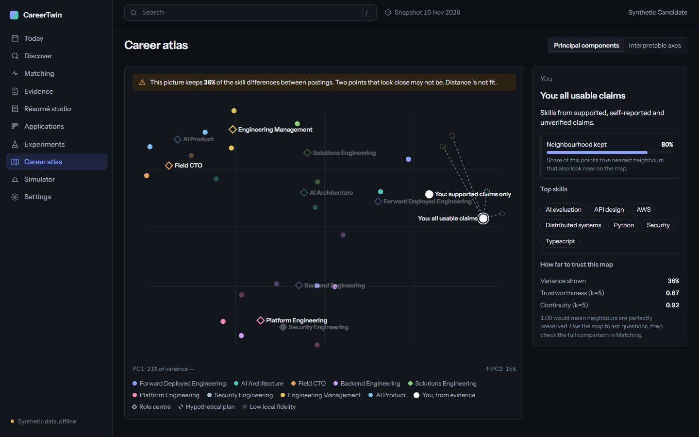 | 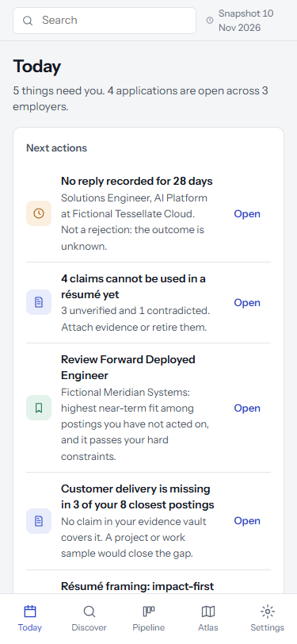 | 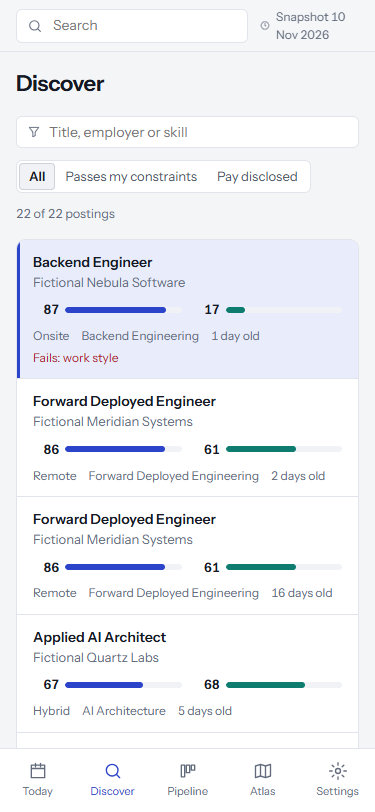 | 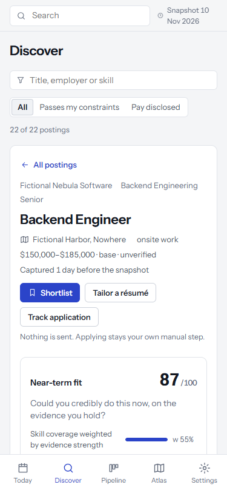 | 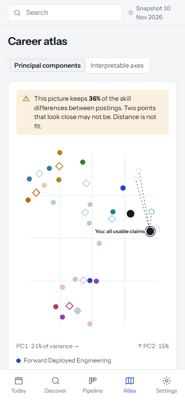 |

Tablet (768 px) and full-length phone pages: `review/concepts/*-768.png`, `*-375.png`.

### B — Ledger
The search as a dossier. A written brief replaces the dashboard; every figure carries a footnote to
the record behind it; postings are a reading list that opens inline into the engine's reasoning.
Source Serif 4 + Public Sans. Strongest on trust and reading; slower for scanning many postings.

| Brief | Postings | Atlas |
|---|---|---|
| 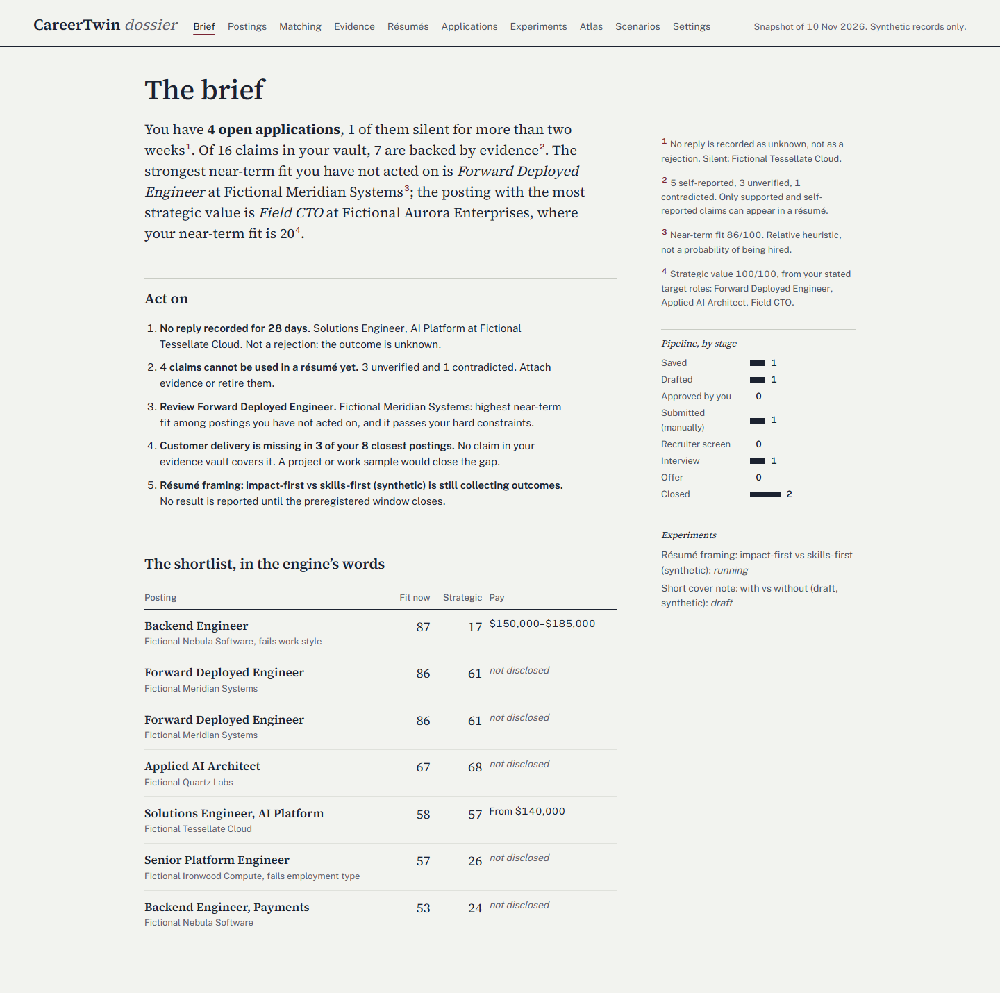 | 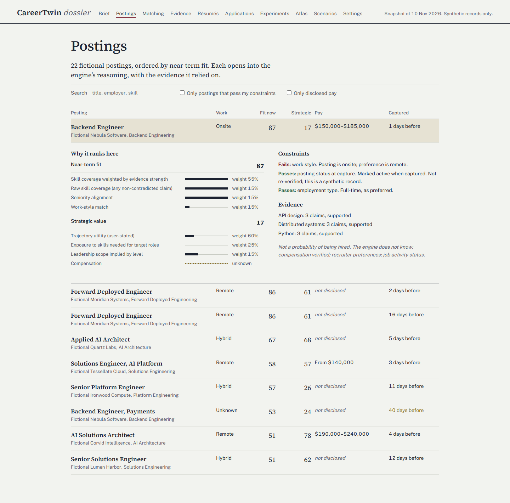 | 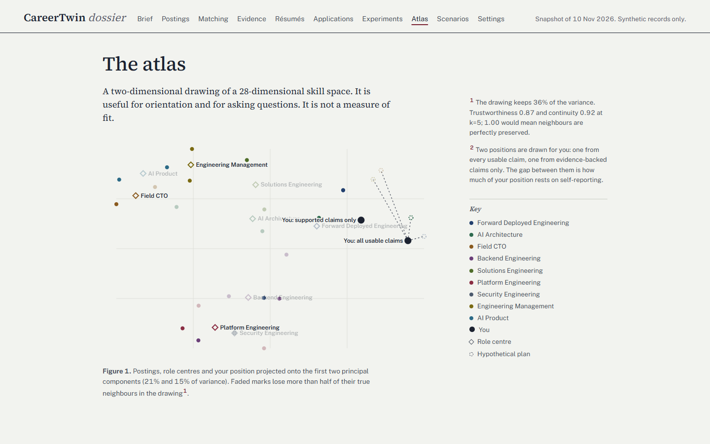 |

### C — Terrain
The career map is home. Postings and plans are read as terrain and routes, with each route's real
planned hours, coverage change and stated uncertainty. Bricolage Grotesque + Public Sans, dark first.
Most distinctive, but it puts the 2-D map — which keeps only 36% of variance — at the centre of every
decision, which is the inference the product warns against.

| Where you stand | Postings | Map |
|---|---|---|
| 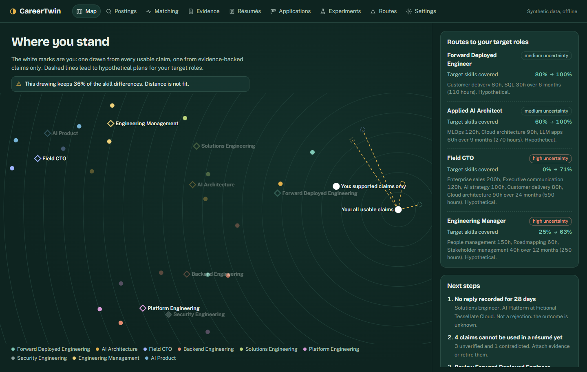 | 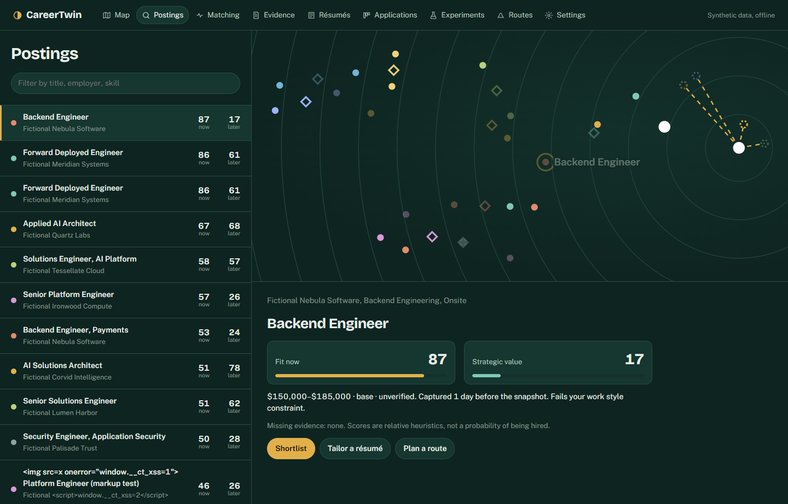 | 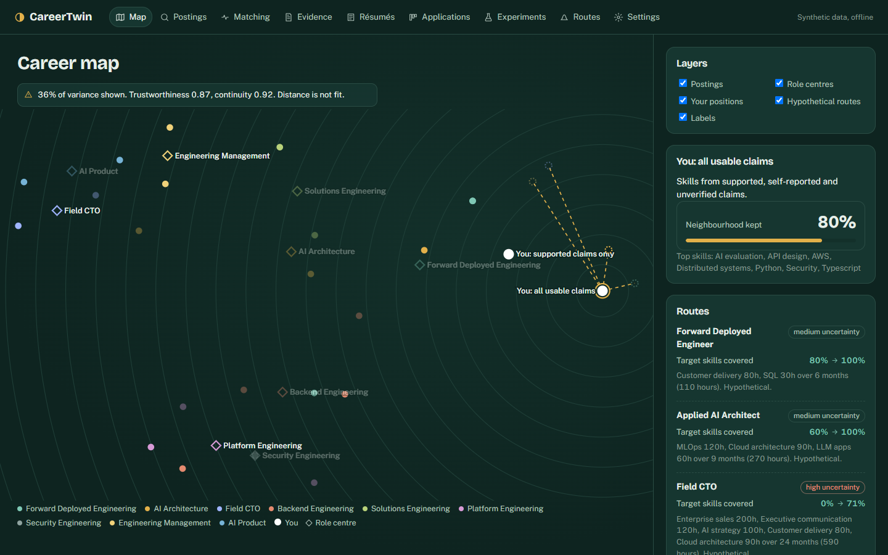 |

## 6. Recommendation: A — Instrument, with two ideas from B and C

**Why Instrument:** the audience manages many postings, applications and claims at once; Instrument
is the only direction that scans 20+ postings on one screen while keeping a full explanation beside
them, which is Jobright's strength, and it adds what Jobright lacks: visible score components and
weights, a separate strategic score, unknowns drawn as unknown, and actions derived from your own
records rather than marketing statistics. It also scales cleanly to the seven screens not shown here
(Evidence, Résumé studio, Applications, Experiments, Simulator, Matching, Settings).

Borrow into Instrument during implementation:
* from **Ledger**: footnoted provenance in the Today brief and serif reading type inside Résumé
  studio, where reading the document is the job;
* from **Terrain**: the route cards (coverage before → after, hours, uncertainty) for the Simulator.

Known issues to fix during implementation (found in the concept critique): label collisions near the
two candidate points on the atlas; a real responsive plot instead of fixed geometry; the Interpretable
axes toggle is visual only in the concept.

## 7. Approval request

Please choose one of:
1. **Approve A — Instrument** (with the two borrowed ideas) and start the ten-screen implementation.
2. Approve B or C instead.
3. Request changes to a direction before implementation.

Nothing beyond the concept harness will be built until you answer.
