# CareerTwin OS — journey prototypes for owner approval

Status: **prototypes for review. No production screen was redesigned in this round.** The owner did not approve
`5cbd3b7` as meeting the Jobright minimum. This round is product-experience design: three connected journeys and
a separate Career Atlas concept.

**Open them:** `/prototypes.html` next to the app. Add `?source=artifacts` to run on the pipeline output, for example
`http://127.0.0.1:<port>/prototypes.html?source=artifacts#/discover`.

**How they're built:**
- The prototypes run on the product's own validated bundle, workspace reducer and safety gates (`AppProvider`). They are a working flow, not mock-ups.
- In artifact mode every change stays in the browser tab and is never saved or sent.
- Screenshots below are real Chrome captures on the real synthetic A/B/C run (`run-20261113T024813Z`: 160 postings, 48 ranked).

## Brief (Impeccable "shape"; assumptions marked)

- **Who and when:** a job seeker in an active search (synthetic candidate). Operate mode: they come to decide, prepare and follow up, not to admire a dashboard.
- **Success:**
  - Decide quickly whether a posting is worth pursuing, and why.
  - Produce a truthful, role-targeted résumé without fabrication.
  - Always know the next action for each application.
- **What only CareerTwin can claim:** every reason traces to a claim and its evidence; unknowns are shown as unknown; nothing is submitted or written for the user.
- **Assumption:** the discovery interview was skipped because the owner's brief already settled purpose, journeys and boundaries. The approval gate sits at this prototype stage instead.

## Skills used

| Skill | Use in this round |
|---|---|
| Impeccable | `shape` playbook (text only; the launcher binary was not run) for the brief. Operate-mode restraint, plus craft-floor rules from the previous round. |
| Frontend Design | One bold element per screen: the reason marks in Discover, the coverage count in Tailor, the next-action card in Track. Sentence case, plain user language. |
| UI UX Pro Max | Back navigation through history, deep links, state preservation, progressive disclosure (built-in reference rules, as recorded in CORRECTION.md). |
| Web Design Guidelines | Lists over 50 items are paged (40 at a time); URL reflects the selected job or application; destructive and committing steps are confirmed. |

## Benchmark (public, logged-out sources only)

The sources are listed below. Teal's pages returned 403 to direct fetching, so its claims come from search excerpts of the named help articles and are less certain.

| Pattern | Product evidence | What CareerTwin does instead (no copying) |
|---|---|---|
| "Why this job is a match", honest about limits | Simplify: [job matches](https://help.simplify.jobs/en/articles/2166608-using-your-job-matches) (a match "does not establish that you meet every employer requirement") | "Why this could fit you", "What stands in the way" and "What would improve your fit", each item tracing to a claim, a constraint or the engine's own hypothetical |
| Match score from skills and seniority, fit and gaps | Jobright: [AI job match](https://jobright.ai/ai-job-match) | A standing within this feed ("Among your closest matches") plus both engine scores, which are never blended and never a hiring probability |
| Master résumé, bullets switched per job, keyword states present / missing / in master but hidden | Teal: [Job Matcher](https://help.tealhq.com/en/articles/12060992-using-the-job-matcher), [tailor for a job](https://help.tealhq.com/en/articles/14435726-how-to-tailor-your-resume-for-a-specific-job) | Lines from your résumé switched on or off, vault claims added verbatim, and coverage states "Covered, backed by evidence", "Covered, self-reported", "In your vault, not in this résumé", "No claim covers it". AI bullet generation is shown as unavailable |
| Target job, keyword match, highlighted changes, then apply | Simplify: [build and tailor](https://help.simplify.jobs/help/articles/8040103-build-and-tailor-your-resume-on-simplify), [resume score](https://help.simplify.jobs/help/articles/2175778-understand-resume-score-and-keyword-matching) | Step 3 is a line-level diff against the base, with truthfulness linting. Step 4 is an explicit approval of the exact text, then export |
| Score per qualification, undo, save as base | Huntr: [tailored résumé](https://help.huntr.co/en/articles/13005373-building-your-tailored-resume) | Each draft is a new version with its parent recorded; approval locks it |
| Job card with deadline, activities and tasks, documents, contacts | Huntr: [job board](https://help.huntr.co/en/articles/13413245-the-job-board), [job card](https://help.huntr.co/en/articles/12640406-understanding-the-job-card), [activities](https://help.huntr.co/en/articles/10042702-activities) | A per-application workspace: stage progress, one **next action**, follow-ups, the linked résumé, activity with who recorded what, and notes. Contacts and attachments are shown as unavailable |
| Follow-up dates, close reasons, notes per job | Teal: [job tracker guidance](https://help.tealhq.com/en/articles/9530119-job-tracker-guidance), [notes](https://help.tealhq.com/en/articles/9530145-job-tracker-taking-notes) | After 14 days of silence the next action becomes a follow-up, "an unknown outcome, not a rejection"; a local follow-up date; a note template you edit and send yourself |
| Archive separate from delete, statuses you approve | Simplify: [job tracker](https://help.simplify.jobs/help/articles/2140179-use-the-job-tracker) | The stage gates are the reducer's: approval before submission, and submission only as your own self-reported record |

**Shown as unavailable, never imitated:** auto-apply, autofill or browser extensions, live job feeds, AI rewriting, emails or chat, email-inferred status, LinkedIn connections, push or email reminders, PDF/Word export, contacts, attachments.

## Journey 1: Discover → Job details → Explain fit → Shortlist

| Current (`5cbd3b7`) | Proposed |
|---|---|
| 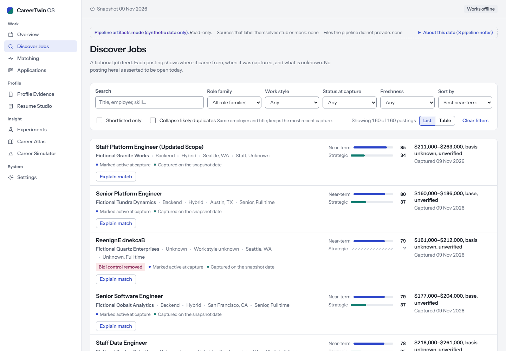 | 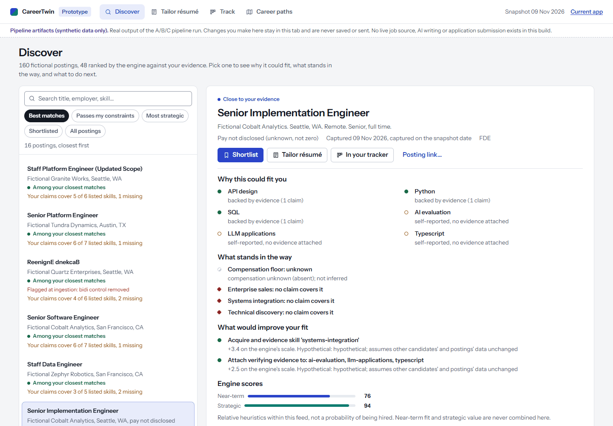 |
| 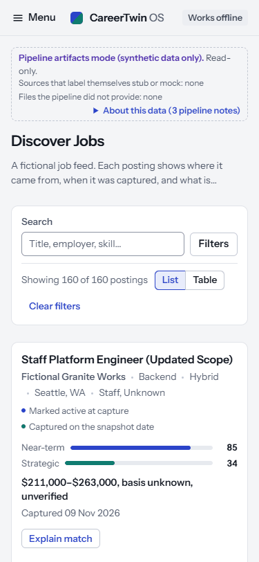 | 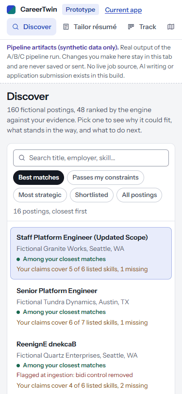 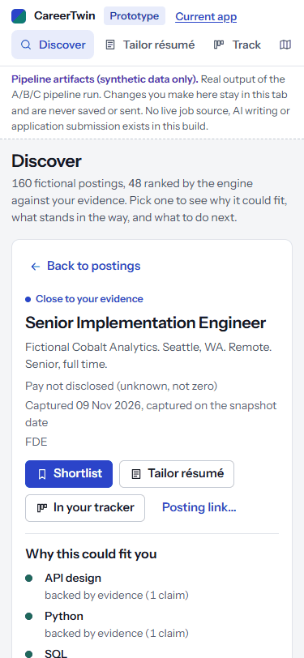 |

**What changed:**
- The list and the explanation are one workspace instead of two screens (Discover and Matching).
- Each row says where the posting stands in this feed and gives one plain reason or blocker ("Your claims cover 5 of 6 listed skills, 1 missing").
- The detail answers the four questions the review asked: why me, what blocks this, what would improve fit, what next (Shortlist, Tailor résumé, Save to tracker).
- Scores are secondary, and the engine math is behind "How the engine computed these".
- Ingestion security flags show on the row and the detail.
- Views: Best matches, Passes my constraints, Most strategic, Shortlisted, All.
- On phones it's a list/detail flow with Back focus restoration.

**Why it's easier:** the decision a person makes ("pursue or not, and what to do") is answered in the first screen of the detail, in their words. Before, you had to cross-read a card, a separate Matching page and component weights.

## Journey 2: Job → Résumé adaptation → Evidence and diff review → Approval and export

| Current | Proposed |
|---|---|
| 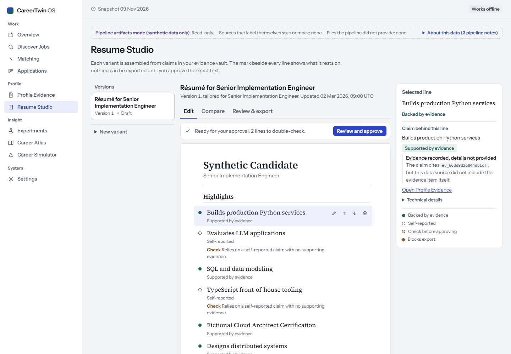 | 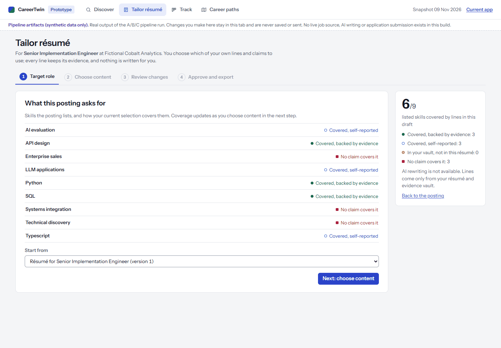 |
| | 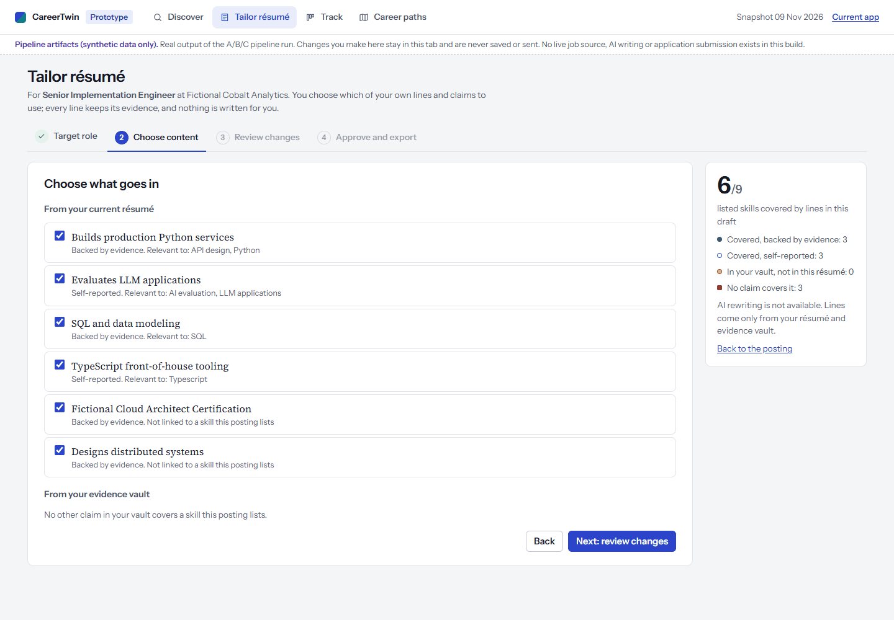 |
| | 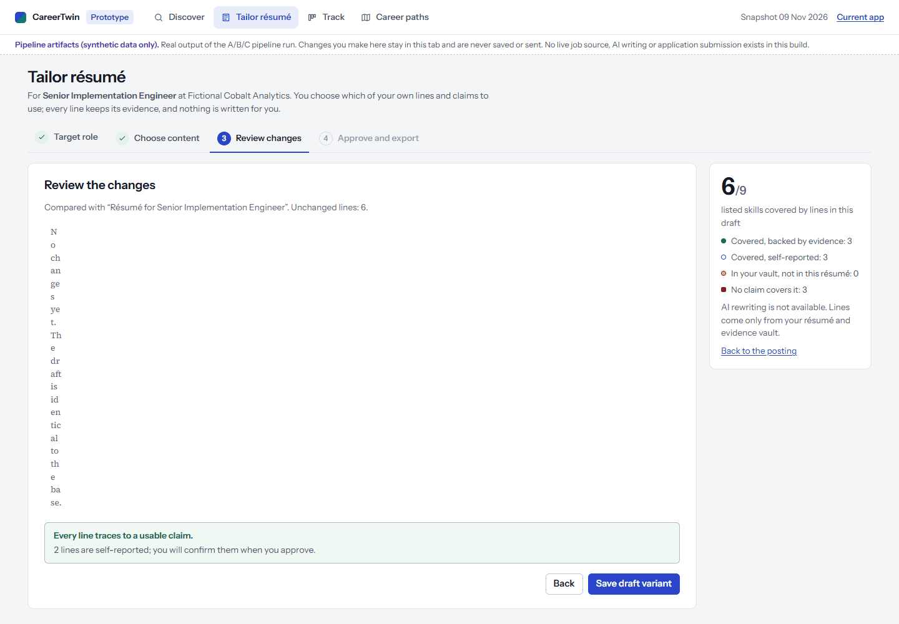 |
| 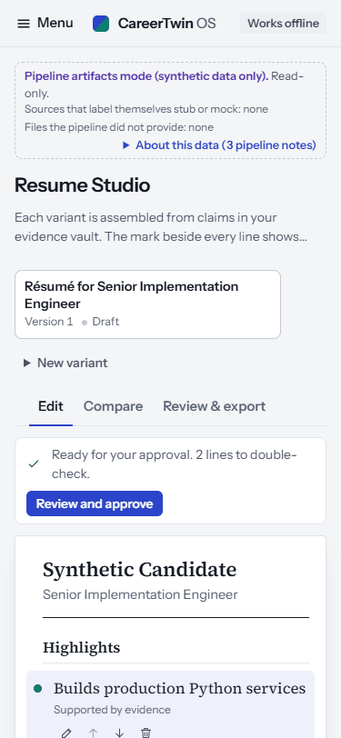 | 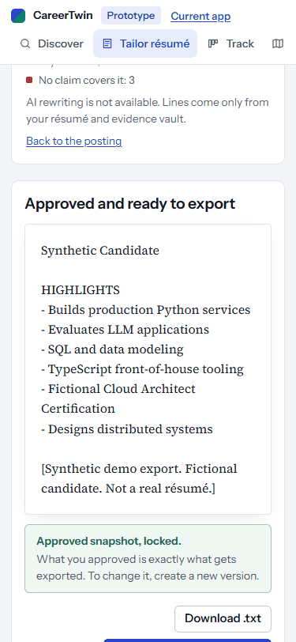 |

**What changed:** four steps, in the order a person thinks about it.
1. **Target role:** the posting's skills and how your selection covers them.
2. **Choose content:** switch your résumé lines on or off, and add vault claims verbatim. Blocked claims show the reason (private, unverified, contradicted).
3. **Review changes:** added and removed lines, plus the truthfulness linter's verdict.
4. **Approve and export:** read the exact text, confirm, lock, download, then add it to the tracker as approved.

A coverage count ("6/9 listed skills covered") stays visible throughout.

**Why it's easier:** the user's question is "is my résumé right for this job, and is it all true?", not "edit my claim ledger". Nothing is generated, so there is nothing to fact-check except their own lines. The rules are the product's existing linter, reducer gates and approval digest.

## Journey 3: Saved job → Application tracking → Next action and follow-up

| Current | Proposed |
|---|---|
| 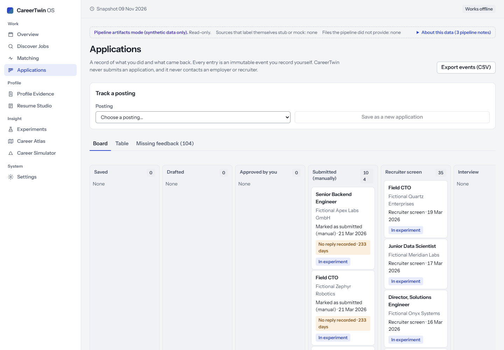 | 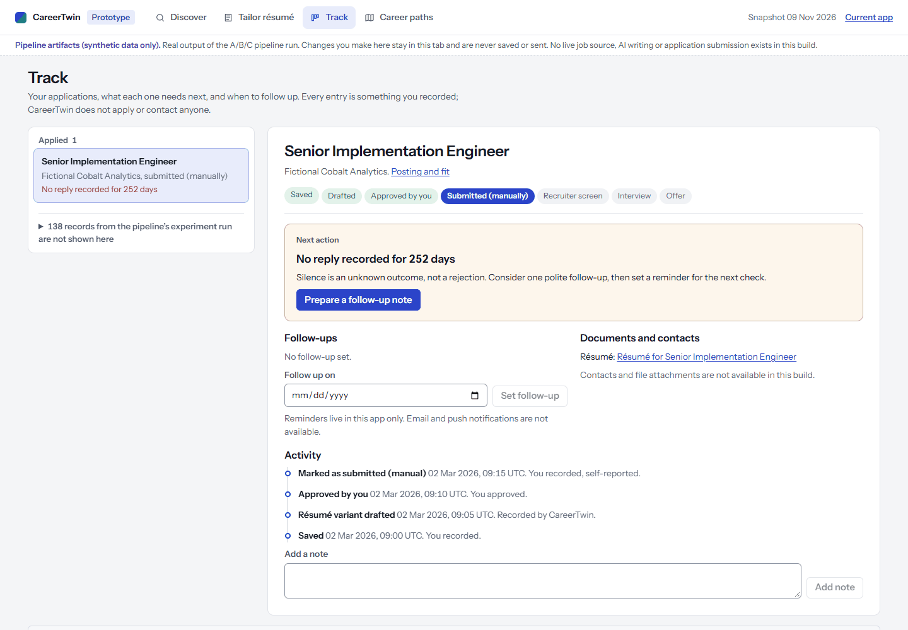 |
| 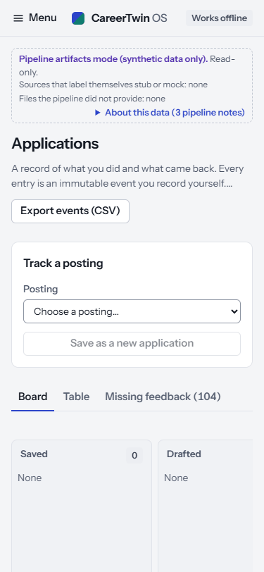 | 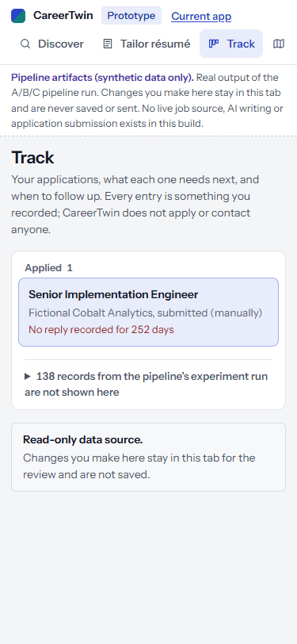 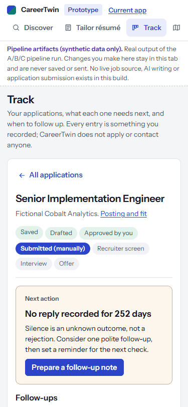 |

**What changed:**
- Applications are grouped by what they need (Preparing, Applied, In conversation, Closed), and each row shows its next action.
- The detail leads with one **Next action** card for the stage:
  - **Saved:** tailor and approve a résumé.
  - **Approved:** apply on the employer's site yourself, then record it (with a confirmation).
  - **Silent after 14 days:** prepare a follow-up note (a template you send yourself) and set a follow-up date.
- Below the card: stage progress, follow-ups, the linked approved résumé, activity labelled by who recorded it ("You recorded", "Recorded by CareerTwin", "Imported"), and notes.

**Truthful state, fixed in the prototype.**
- The pipeline's experiment stage simulates applications. In this run it produced 138, with events labelled `actor: "user"`, "approved" and "manually submitted".
- The current app merges them into your applications.
- The prototype now carries their source (`experiment_events.json`) through the bundle as an internal flag (no contract change).
- It keeps those records out of your applications, follow-ups and counts, and says so: "138 records from the pipeline's experiment run are not shown here".

**Why it's easier:** the tracker answers "what should I do next, and when do I follow up?" for each job. Silence is never treated as rejection, and what you did is never mixed with what a simulator did.

## Career Atlas concept: transitions and decisions

| Current | Proposed |
|---|---|
| 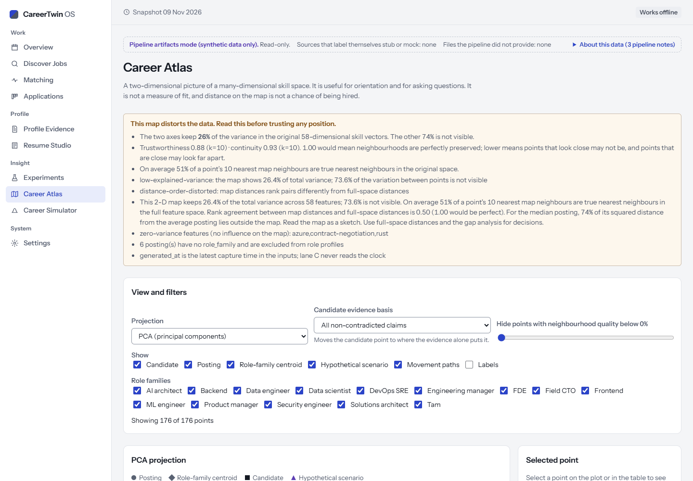 | 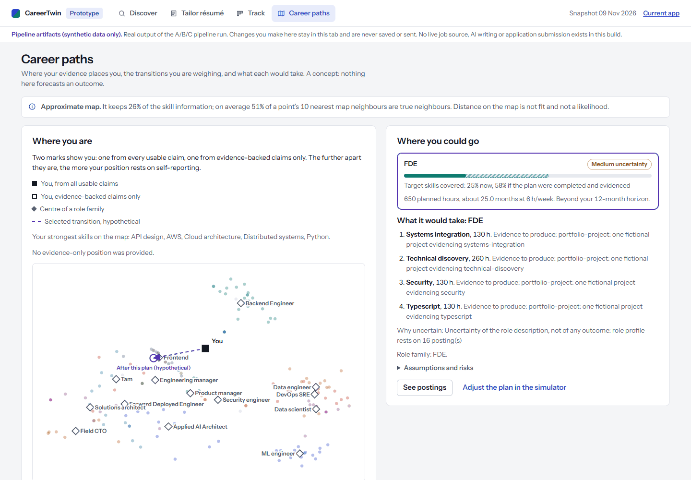 |
| 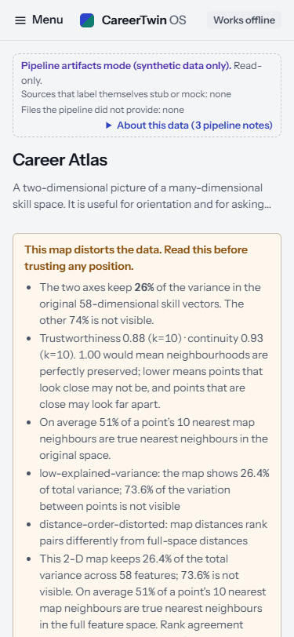 | 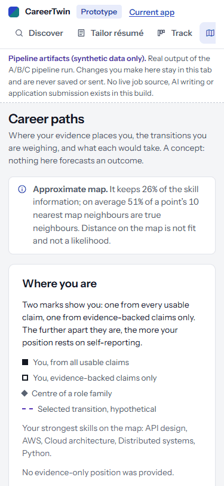 |

**What changed:**
- The page is a storyline:
  - **Where you are:** two marks, from all usable claims and from evidence-backed claims only.
  - **Where you could go:** transition cards with target-skill coverage now and if completed, planned hours, months at your pace, horizon fit and stated uncertainty.
  - **What it would take:** the planned actions with evidence goals, plus assumptions and risks on demand.
- The selected route is drawn on a quiet map.
- **Uncertainty always visible:** one plain line above the map says how much the map keeps, how often near means near, and that distance is not fit or likelihood. Full diagnostics are one click away.
- The full map, filters and table remain in the current app.

**Honest observation surfaced, not hidden:**
- In this run, the FDE plan's hypothetical end position lands next to the Frontend centre on the 2-D map, not the FDE centre.
- The concept says under the map that the end of the route need not sit next to the role's centre and that distance is not fit.
- This is raised with lane E as a data observation for lane C.

## Verification

| Check | Result |
|---|---|
| `npm run typecheck` | clean (now includes `prototypes/`) |
| `npm test` | 159 / 159 |
| `CT_E2E_PORT=4186 npx playwright test` | **57 passed, 1 skipped**. The new `tests/e2e/prototypes.spec.ts` covers four flows: journey 1 desktop and phone (focus restoration, no overflow); journeys 2→3 end to end (switch off blocking lines, add a claim, review the diff, save, confirm, approve, export enabled, add to tracker, record the application with confirmation, follow-up template, follow-up date); and artifact mode (generated experiment records excluded, Atlas uncertainty visible). Every screen passes axe WCAG 2.1 AA. |
| `npm run test:integration` | 1 / 1 |
| Production build | `prototypes.html` ships beside `index.html`; CSP unchanged |

## Open decisions for the owner

1. Approve, or change, each of the three journeys and the Atlas concept. The remaining screens are redesigned only after that approval.
2. **Experiment records:** should the product (not just the prototype) keep pipeline-generated experiment applications out of "your applications"? The fix is ready in the prototype. Lanes B and E are asked separately whether those events should stop claiming `actor: "user"`.
